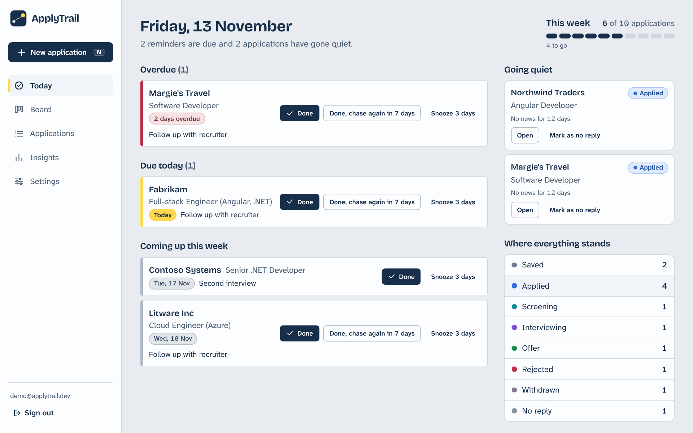
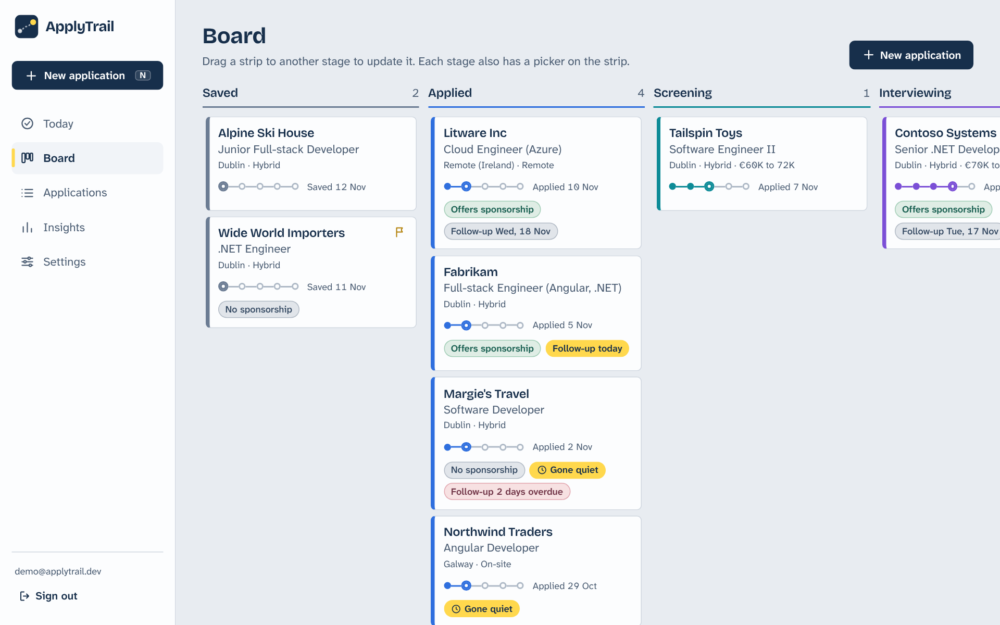
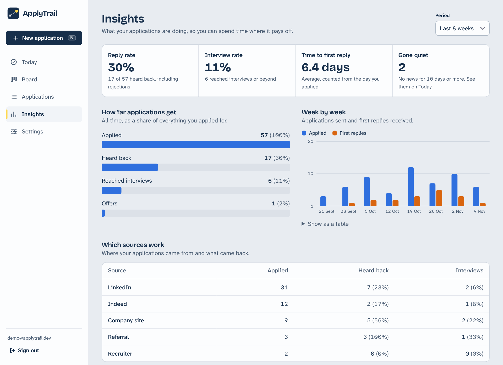

# ApplyTrail

A job-application tracker for people who apply constantly. Log each role once, and ApplyTrail schedules the follow-ups, flags what has gone quiet, warns you before you apply twice, and shows which sources actually get replies.

Built with **.NET 10**, **Angular 22** and **SQLite**. One `docker compose up` runs the whole thing.

<p>
  
</p>

<table>
  <tr>
    <td width="50%"></td>
    <td width="50%"></td>
  </tr>
</table>

_Screenshots use made-up sample data._

## Why this exists

Applying for jobs in volume goes wrong in the same few ways: you forget to follow up, you cannot remember which applications are still alive, you apply to the same role twice from two job boards, and you have no idea whether LinkedIn or a company's own site is working better for you. A spreadsheet can hold the rows. It cannot tell you what to do today.

## What it does

- **Today.** The first screen answers "what needs doing?": overdue and due follow-ups, applications that have gone quiet, and progress toward your weekly goal.
- **Automatic follow-ups.** Mark a role as Applied and a reminder is set for a week later (configurable). When they reply, the chase reminder is cancelled. When you mark it Rejected, Withdrawn or No reply, every open reminder is.
- **Duplicate warning.** While you type, it checks your existing applications by job link and by company plus a similar title, so a re-posted job does not become a second application.
- **Board and list.** Drag strips between stages, or use the status picker on any strip (works with a keyboard and on a phone). Search, filter by status, source, priority and visa sponsorship, sort, and archive.
- **Timeline.** Every status change is logged automatically; add emails, calls, interviews and notes yourself.
- **Insights.** Reply rate, interview rate, average days to a first reply, weekly volume, and results by source. It tells you when the sample is too small to trust.
- **Yours to keep.** Export everything as CSV (opens in Excel) or a full JSON backup, and delete your account and data from Settings.
- **Visa-aware.** Mark whether a role offers sponsorship and filter on it, which matters if you need it.

The signature detail is the **strip**: each application is a slim slip with a coloured status tab and a five-stop track showing how far it got, so you can read a whole pipeline at a glance.

## Quick start (Docker)

You need [Docker](https://docs.docker.com/get-docker/) with Compose.

```bash
git clone <your-repo-url> applytrail
cd applytrail
cp .env.example .env        # Windows PowerShell: Copy-Item .env.example .env
```

Open `.env` and set `JWT_SIGNING_KEY` to a long random value (the file explains how to generate one). To try the app with sample data, also set `SEED_DEMO_DATA=true`. Then:

```bash
docker compose up --build
```

Open <http://localhost:8080>. With demo data on, sign in as `demo@applytrail.dev` with password `demo-password-123`; otherwise create an account.

Your data lives in a Docker volume (`applytrail-data`) and survives restarts and rebuilds.

## Run it for development

Prerequisites: [.NET 10 SDK](https://dotnet.microsoft.com/download), [Node.js 22](https://nodejs.org) (includes npm), Git.

```bash
# 1. Create the first database migration (once, then commit the generated files)
dotnet tool restore
dotnet ef migrations add InitialCreate -p src/ApplyTrail.Infrastructure -s src/ApplyTrail.Api -o Migrations

# 2. Run the API on http://localhost:5080 (Development mode seeds the demo account)
dotnet run --project src/ApplyTrail.Api

# 3. In a second terminal, run the Angular app on http://localhost:4200
cd web
npm install
npm start
```

The dev server proxies `/api` to the API, so the browser sees a single origin, exactly as in production.

API documentation (Scalar) is served in Development at <http://localhost:5080/scalar>.

### Tests

```bash
dotnet test                          # unit + integration tests
cd web && npm test -- --watch=false  # frontend tests
```

## Configuration

Set these as environment variables (in Docker, via `.env`). In .NET, a double underscore stands for a nested key: `Jwt__SigningKey` is `Jwt:SigningKey`.

| Setting | Default | What it does |
|---|---|---|
| `Jwt__SigningKey` | none (required outside Development) | Secret used to sign login tokens. At least 32 characters. |
| `Auth__CookieSecure` | `true` | Marks the sign-in cookie `Secure`. Set `false` only for plain-http local use. |
| `Auth__AllowRegistration` | `true` | Turn off after creating your account on a public server. |
| `RateLimiting__AuthPermitsPerMinute` | `10` | Sign-in, sign-up and refresh attempts allowed per client per minute. |
| `ConnectionStrings__Default` | `Data Source=applytrail.db` | SQLite file location. |
| `Seed__DemoData` | `false` | Creates the demo account and sample applications at startup. |

## How it is built

```
src/
  ApplyTrail.Domain          Entities and rules (status changes, reminders). No dependencies.
  ApplyTrail.Application     Use cases, DTOs, and the pure calculators behind Today and Insights.
  ApplyTrail.Infrastructure  EF Core + SQLite, JWT and password handling, demo seeding.
  ApplyTrail.Api             ASP.NET Core controllers, auth wiring, rate limiting, OpenAPI.
tests/
  ApplyTrail.UnitTests         Domain rules and calculators (no database).
  ApplyTrail.IntegrationTests  The real API in-process against a throw-away SQLite file.
web/                         Angular 22: standalone components, signals, Tailwind CSS 4, Angular CDK.
```

Highlights:

- Plain layered design with no mediator or mapper libraries. The rules that matter live in the domain and are unit-tested.
- Sessions use a 15-minute access token held **in memory only** plus a rotating refresh token in an `HttpOnly`, `SameSite=Strict` cookie. Reusing a rotated refresh token ends every session for that user.
- The browser talks to one origin (nginx serves the app and proxies `/api`), so there is no CORS to configure and the cookie never travels cross-site.
- Dates that mean "a calendar day" (applied on, reminder due) are date-only values; the client sends its own "today" so reminders are right in any time zone.

More detail: [docs/ARCHITECTURE.md](docs/ARCHITECTURE.md), [docs/API.md](docs/API.md), [docs/DEPLOYMENT.md](docs/DEPLOYMENT.md).

## Roadmap

Ideas, roughly in order of usefulness:

- Email or push reminders (today you see them when you open the app)
- A browser extension to save a job page in one click
- Import from CSV, so a spreadsheet can be moved in
- Calendar (`.ics`) feed for interviews and follow-ups
- PostgreSQL as an alternative to SQLite for shared hosting

## Contributing

See [CONTRIBUTING.md](CONTRIBUTING.md). Licensed under the [MIT License](LICENSE).
