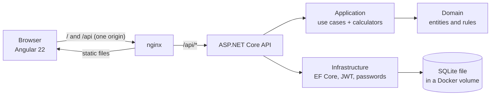
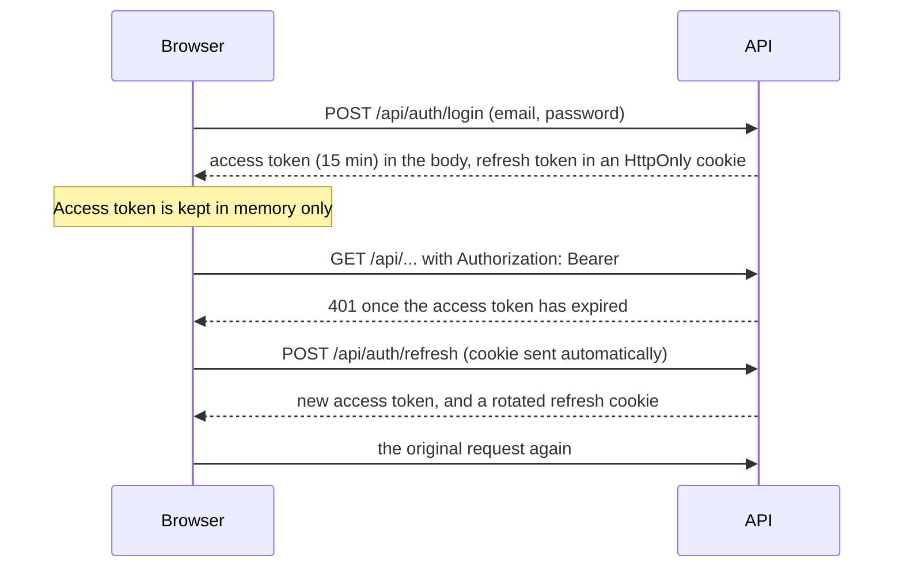
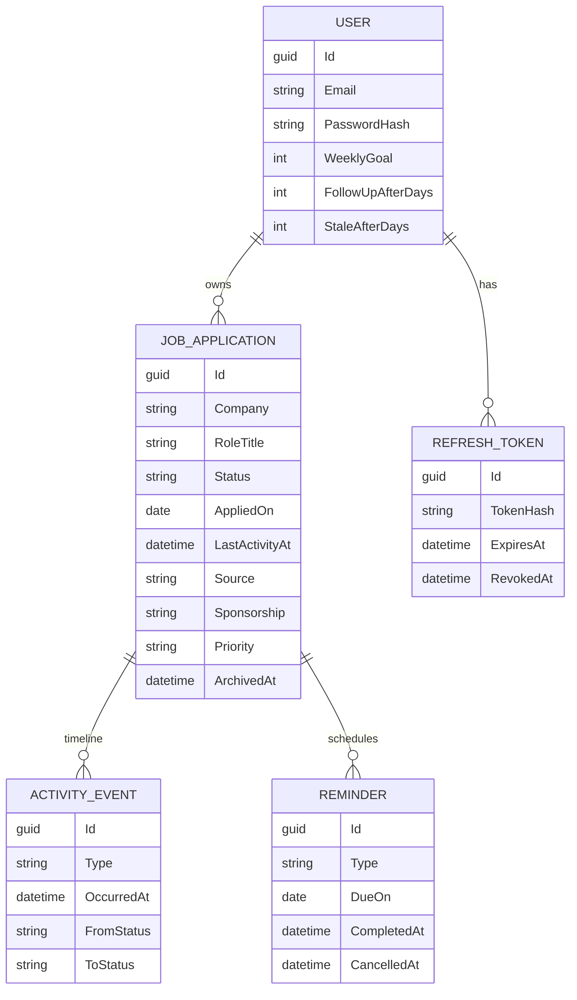

# Architecture

## The shape of it

Dependencies point inwards. `Domain` references nothing. `Application` references `Domain` and EF Core's abstractions (through `IApplicationDbContext`). `Infrastructure` and `Api` sit on the outside. The pure calculators for Today and Insights compile and run without EF at all.

## Decisions worth explaining

| Decision | Why |
|---|---|
| **SQLite** | One user's job search is hundreds of rows, not millions. A single file is trivial to run, back up and host for free. Switching provider later means changing `AddInfrastructure`. |
| **No MediatR or AutoMapper** | There are about 25 endpoints. A service per area and hand-written mapping is shorter, easier to follow and easier to debug than pipelines and profiles. |
| **Rules on the entities** | `JobApplication.ChangeStatus` decides when to stamp the applied date, cancel reminders and log the change. It is plain C#, so it is unit-tested without a database. |
| **Insights computed in memory** | The service loads a user's applications and passes them to pure functions. That is simpler to test than SQL, and fast enough at this scale. |
| **Date-only values for calendar days** | "Applied on 6 Nov" and "follow up on 13 Nov" are dates, not instants. The client sends its own "today", so "overdue" is right in any time zone. The server accepts only a two-day tolerance, to stop absurd values. |
| **Same-origin deployment** | nginx serves the app and proxies `/api`. No CORS, and the refresh cookie can be `SameSite=Strict`. |
| **Native `<dialog>`, Angular CDK for drag-drop only** | Less code and better accessibility than a component library, with focus handling and Esc for free. |

## Sign-in and sessions

- The refresh token is 256 bits of randomness, stored server-side only as a SHA-256 hash.
- It is **rotated** on every use. Presenting an already-rotated token again, after a 10-second allowance for two tabs refreshing at once, is treated as theft and ends every session for that user.
- Passwords use ASP.NET Core's PBKDF2 hasher. Sign-in does the same work for unknown emails, so response time does not reveal who has an account.
- Access tokens are signed with HS256, the algorithm is pinned (a token claiming another algorithm is rejected), and the signing key must be at least 32 characters outside Development or the app refuses to start.
- Sign-in, sign-up and refresh are rate limited per client.

## Data model

Enums are stored as their names, so the database is readable and reordering an enum never corrupts data. Deleting an application or a user cascades to everything below it.

## Business rules (all in `ApplyTrail.Domain`)

- Statuses: Saved, Applied, Screening, Interviewing, Offer, Rejected, Withdrawn, Ghosted (shown as "No reply").
- Moving out of Saved stamps the applied date. Becoming Applied schedules a follow-up (applied date plus the user's follow-up days, and never in the past).
- A reply (Screening, Interviewing, Offer, Rejected) cancels open **follow-up** reminders. Interview and deadline reminders stay.
- Rejected, Withdrawn and Ghosted cancel every open reminder.
- Notes do not count as activity, so adding a note does not hide a stale application.
- An active application (Applied, Screening, Interviewing) is **stale** once it has had no activity for the configured number of days.

### Insight definitions

| Measure | Definition |
|---|---|
| Applied | has an applied date |
| Heard back | is, or ever was, Screening, Interviewing, Offer or Rejected |
| Reached interviews | is, or ever was, Interviewing or Offer |
| Days to first reply | applied date to the first move into a reply status (real transitions only) |
| Weeks | start on Monday |

Archived applications count in Insights and the weekly goal, but not in Today's reminders or status counts.

## Security notes

- Every query filters by the signed-in user; another user's id returns 404, the same as a missing one.
- Responses are `Cache-Control: no-store`; the API sets `X-Content-Type-Options: nosniff`. nginx adds a strict Content-Security-Policy (no inline scripts), `frame-ancestors 'none'` and a referrer policy.
- User text is exported to CSV with a guard against spreadsheet formula injection.
- The request body is capped at 256 KB.
- Account deletion requires the password again and removes all of the user's data.
- Over https, set `Auth__CookieSecure=true`; add HSTS at the TLS-terminating proxy.
